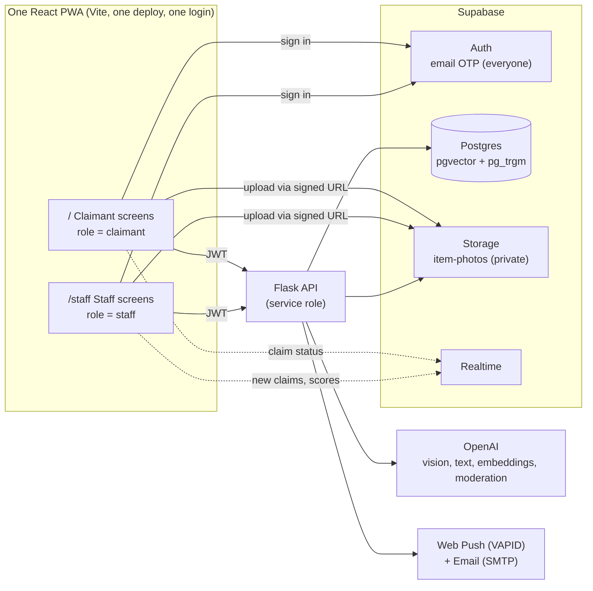
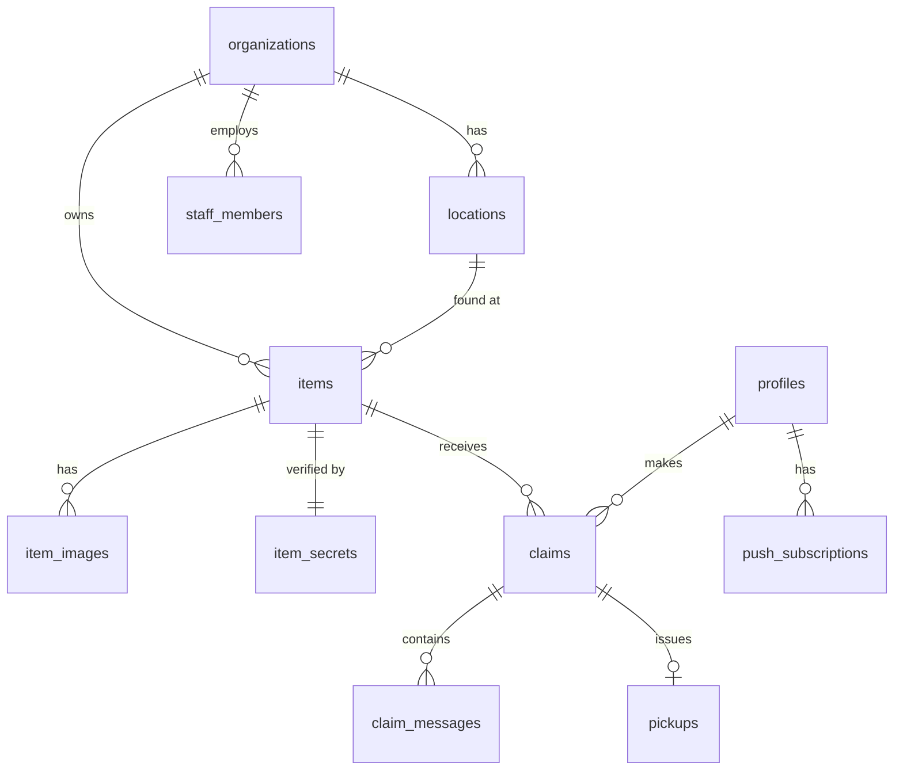
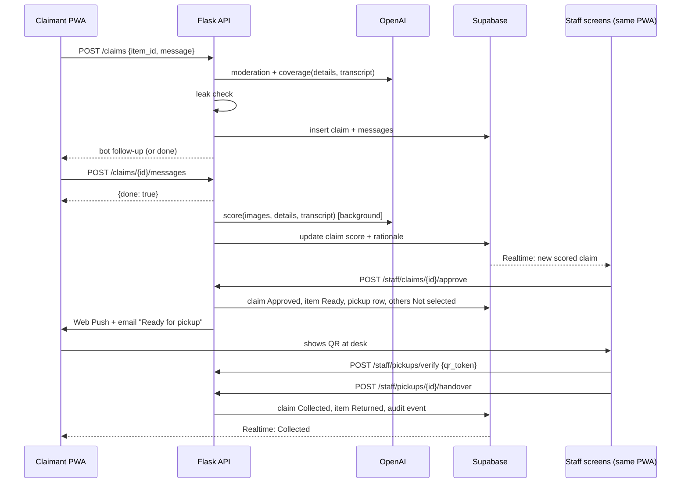

# Architecture Document: [App name]

**Stack:** One React (Vite) PWA for claimants and staff (role-based UI) · Python Flask API · Supabase (Auth, Postgres, Storage, Realtime) · OpenAI
**Related:** [User stories workbook](LostFound_MVP_User_Stories.xlsx) · [Design](DESIGN.md)

---

## 1. System overview



**The key rule:** the browser never talks to the database for anything sensitive. All reads and writes that touch items, claims or secrets go through Flask, which uses the Supabase service role. The browser uses Supabase directly for only three things:

1. **Auth:** getting and refreshing the JWT.
2. **Storage uploads:** through short-lived signed upload URLs that Flask issues.
3. **Realtime:** live status updates, protected by RLS.

### 1.1 One app, two roles

```
sign in (email + code) ─▶ GET /v1/me ─▶ { role: "staff",    org } ─▶ /staff  (staff bottom nav)
                                     └▶ { role: "claimant", profile | needs_onboarding } ─▶ /  (claimant bottom nav)
```

- **Role source of truth:** a row in `staff_members` means staff; otherwise the user is a claimant. Flask decides this on every request; the frontend only uses it for routing.
- **Route guards:** `<RequireRole role="staff">` wraps `/staff/*`, and `<RequireRole role="claimant">` wraps the claimant routes. A wrong role is redirected to its own home.
- **API guards:** `@require_staff` on `/v1/staff/*`, `@require_claimant` on claim endpoints. Hiding a screen is never the security boundary; the API is.
- **Code splitting:** the staff tree is lazy-loaded, so claimants never download staff code.

---

## 2. Tech stack

| Layer | Choice | Why |
|---|---|---|
| Frontend | React 18 + TypeScript + Vite | Fastest dev loop; one app for both roles |
| Routing | React Router (`/` claimant, `/staff/*` staff) with role guards | One shell, role-specific bottom nav, staff tree lazy-loaded |
| PWA | `vite-plugin-pwa` (Workbox) | Manifest, service worker and offline shell with little config |
| Styling | Tailwind CSS with the design tokens as CSS variables | Fast, consistent with [DESIGN.md](DESIGN.md) |
| Motion | Framer Motion | Springs, shared elements (`layoutId`), gestures for sheets |
| Server state | TanStack Query | Caching, retries, optimistic updates |
| Forms | React Hook Form + Zod | The same Zod schemas mirror the Validation Rules sheet |
| QR | `qrcode.react` (show), `@zxing/browser` (staff scan) | Small, browser-only |
| Phone | `libphonenumber-js` | Validation and E.164 formatting |
| Backend | Python 3.12 + Flask + Flask-CORS + Flask-Limiter | Team preference; simple |
| Validation | Pydantic v2 | Request and response models; OpenAI structured outputs |
| DB access | `supabase-py` (service role) + RPC functions for search | No ORM to set up during a hackathon |
| Auth | Supabase Auth **email OTP for everyone**; role resolved from `staff_members` | One login, no passwords, zero auth code to write |
| Storage | Supabase Storage with image transforms | Thumbnails on the fly |
| AI | OpenAI: a vision-capable chat model, `text-embedding-3-small`, moderation endpoint | Model names live in environment variables so you can swap them |
| Push | Web Push via `pywebpush` + VAPID keys | Works in Android browsers and in installed iPhone PWAs (iOS 16.4+) |
| Email | Any SMTP provider (e.g. Resend) | Fallback channel, since iPhone push needs the PWA installed |
| Hosting | Frontend: Vercel or Netlify. API: Render, Railway or Fly. DB: Supabase Cloud | Free tiers, deploy in minutes |

---

## 3. Repository layout

```
DevFest/
├── docs/                      # this folder
├── web/                       # React + Vite
│   ├── public/                # manifest icons
│   ├── src/
│   │   ├── auth/              # Email + Code screens, RequireRole guard, role redirect
│   │   ├── claimant/          # Home, Search, Item, Claim chat, Requests, Profile, Onboarding
│   │   ├── staff/             # Staff Home, Items, Add item, Item page, Pickup scanner, Profile (lazy-loaded)
│   │   ├── shared/
│   │   │   ├── ui/            # Button, Input, Chip, Sheet, Toast, Tooltip, BottomNav (role tabs), StepForm
│   │   │   ├── motion/        # spring presets, page transitions
│   │   │   ├── api/           # typed fetch client + TanStack Query hooks
│   │   │   ├── schemas/       # Zod schemas (= Validation Rules sheet)
│   │   │   └── supabase.ts
│   │   └── sw.ts              # service worker: push handler + notificationclick
│   └── vite.config.ts         # vite-plugin-pwa config
├── api/                       # Flask
│   ├── app/
│   │   ├── __init__.py        # create_app, CORS, limiter
│   │   ├── auth.py            # JWT verification, @require_claimant, @require_staff
│   │   ├── routes/            # search.py, items.py, claims.py, pickups.py, me.py, push.py
│   │   ├── ai/                # suggest.py, embed.py, parse_query.py, claim_chat.py, score.py, prompts/
│   │   ├── services/          # notify.py (push + email), storage.py, codes.py
│   │   └── worker.py          # background scoring executor + startup sweep
│   ├── tests/
│   └── requirements.txt
└── supabase/
    ├── migrations/            # SQL: tables, indexes, RLS, RPC functions
    └── seed.sql               # orgs, locations, staff (FND-01)
```

---

## 4. Data model



| Table | Key columns | Notes |
|---|---|---|
| `organizations` | `id`, `name`, `slug` | Seeded |
| `locations` | `id`, `org_id`, `name`, `address`, `lat`, `lng`, `desk_hours` | `pg_trgm` index on `name` and `address` |
| `staff_members` | `user_id` (auth.users), `org_id`, `display_name` | Links a staff login to one org |
| `profiles` | `user_id`, `full_name`, `phone_e164`, `phone_verified=false`, `deleted_at` | Claimants |
| `items` | `id`, `org_id`, `location_id`, `title`, `tags text[]`, `category`, `colours text[]`, `exact_spot`, `found_at`, `status`, `embedding vector(1536)`, `created_by` | `status` is an enum (see the Status Model sheet). HNSW index on `embedding`. |
| `item_images` | `id`, `item_id`, `path`, `position`, `is_cover` | Paths in the private `item-photos` bucket |
| `item_secrets` | `item_id` (PK), `private_description`, `details jsonb` | **RLS on, no policies.** Service role only. `details` is the description split into atomic facts by AI at publish time. |
| `claims` | `id`, `item_id`, `claimant_id`, `status`, `followups_asked`, `score int`, `score_label`, `rationale jsonb`, `model_version`, `proof_image_path`, `scored_at` | Unique on (`item_id`, `claimant_id`) |
| `claim_messages` | `id`, `claim_id`, `role` (bot or user), `content`, `created_at` | Full transcript for staff |
| `pickups` | `claim_id` (PK), `code_hash`, `qr_token`, `expires_at`, `collected_at`, `handed_over_by` | The 6-digit code is stored hashed |
| `push_subscriptions` | `id`, `user_id`, `endpoint`, `p256dh`, `auth` | Web Push |
| `audit_events` | `id`, `org_id`, `actor_id`, `type`, `entity_id`, `data jsonb`, `created_at` | NFR-03 |

### 4.1 Row Level Security summary

| Table | Claimant (authenticated) | Staff | Anon |
|---|---|---|---|
| `item_secrets` | none | none (read through the API only) | none |
| `items`, `item_images` | none directly (read through the API) | none directly | none |
| `claims` | `SELECT` own rows (for Realtime) | `SELECT` where `item.org_id` = their org (for Realtime) | none |
| `profiles` | own row | none | none |

All writes go through Flask. RLS exists so that Realtime subscriptions and any accidental direct query are safe.

---

## 5. API (Flask, `/v1`)

Every request carries `Authorization: Bearer <Supabase JWT>`. Flask verifies it with the project's JWT secret (or JWKS) and then loads either `profiles` (claimant) or `staff_members` (staff).

### Claimant

| Method | Path | Purpose | Story |
|---|---|---|---|
| `GET` | `/me` | Profile, or `{ needs_onboarding: true }` | USR-ONB-02 |
| `PUT` | `/me` | Set name and phone | USR-ONB-03, 04 |
| `DELETE` | `/me` | Delete account, withdraw claims | USR-PRO-01 |
| `GET` | `/places?lat&lng` | Locations with distance and available-item counts | USR-HOME-01 |
| `GET` | `/items/recent?lat&lng` | Recently found items | USR-HOME-01 |
| `POST` | `/search` | `{q, lat?, lng?, location_id?, page}` returns `{parsed, results, next_page}` | API-SRCH-01 |
| `GET` | `/items/{id}` | Public item view (**never includes secrets**) | USR-ITEM-01 |
| `POST` | `/claims` | `{item_id, message}` creates a claim and returns the bot reply | API-CLM-01 |
| `POST` | `/claims/{id}/messages` | `{message}` returns the next bot reply or `{done: true}` | USR-CLM-02 |
| `POST` | `/claims/{id}/proof-upload-url` | Signed upload URL for the proof photo | USR-CLM-03 |
| `GET` | `/claims` | My requests | USR-REQ-01 |
| `GET` | `/claims/{id}/pickup` | QR token + code (approved claims only) | USR-REQ-02 |
| `POST` | `/push/subscribe` | Save a Web Push subscription | USR-NOT-01 |

### Staff

| Method | Path | Purpose | Story |
|---|---|---|---|
| `GET` | `/staff/dashboard` | Stat tiles, return rate, needs-attention list | STF-DASH-01 |
| `POST` | `/staff/uploads` | Signed upload URLs for item photos | STF-ITEM-02 |
| `POST` | `/staff/items/suggest` | `{image_paths}` returns `{title, category, colours}` | STF-ITEM-03 |
| `POST` | `/staff/items` | Create item + images + secret + embedding (one transaction) | API-ITEM-01 |
| `GET` | `/staff/items` | List with filters | STF-ITEM-06 |
| `GET` `PATCH` | `/staff/items/{id}` | Detail and edit | STF-ITEM-07 |
| `POST` | `/staff/items/{id}/archive` | `{reason}` | STF-ITEM-07 |
| `GET` | `/staff/items/{id}/claims` | Claims sorted by score desc | STF-CLM-01 |
| `POST` | `/staff/claims/{id}/approve` | Approve, issue pickup, close the others, notify | STF-CLM-02 |
| `POST` | `/staff/claims/{id}/reject` | `{reason, note?}` | STF-CLM-03 |
| `POST` | `/staff/claims/{id}/rescore` | Retry failed scoring | STF-CLM-01 |
| `POST` | `/staff/pickups/verify` | `{code}` or `{qr_token}` returns claim preview | STF-CLM-04 |
| `POST` | `/staff/pickups/{claim_id}/handover` | Mark collected and returned | STF-CLM-04 |

**Errors** use one shape: `{ "error": { "code": "VALIDATION", "message": "...", "fields": { "title": "..." } } }`. Field messages match the Validation Rules sheet.

**Rate limits** (Flask-Limiter, keyed by user ID): search 30 a minute, claim creation 5 a day, claim messages 20 an hour, pickup verification 10 a minute per staff member.

---

## 6. AI pipelines

All OpenAI calls use **structured outputs** (a JSON schema defined in Pydantic) and a timeout. User text is always passed as clearly delimited data, and the system prompt states that it must never be treated as instructions.

### 6.1 Item suggestion (STF-ITEM-03)

```
2+ photos ──▶ vision model ──▶ { title, category, colours[], sensitive_regions[] }
```

- The title must be generic: "Black backpack", never "Nike backpack with Ali's name tag".
- `sensitive_regions` (faces, ID numbers) feeds the optional auto-blur (NFR-04).
- Timeout 8s. On failure the fields stay empty.

### 6.2 Publish: secrets and embedding (API-ITEM-01)

1. The text model splits `private_description` into atomic `details`: `["blue Nike bottle inside", "cat keychain", "scratch near zip"]`. These are stored in `item_secrets.details`.
2. The `title + category + colours + tags` string is embedded with `text-embedding-3-small` and stored in `items.embedding`.
3. **The private description is never embedded into a searchable column** (decision D4).

### 6.3 Search (API-SRCH-01)

```
"black bag in atrium mall"
        │
        ▼
 parse_query (text model, cached 24h)  ─ fallback: regex split on " in | at | near "
        │
        ▼
 { what: "black bag", where: "atrium mall" }
        │
        ├─ what  ──▶ embed ──▶ vector similarity on items.embedding
        │                      + trigram similarity on title/tags
        └─ where ──▶ trigram match on locations.name / address  (≥ 0.3)
        │
        ▼
  rank = 0.7 * vector + 0.3 * keyword, filtered to Available or Claim pending
```

This is implemented as one Postgres function, `search_items(query_embedding, what_text, where_text, lat, lng, page)`, called through RPC, so ranking happens in the database.

### 6.4 Claim chat: coverage and follow-up (USR-CLM-02)

Each user turn runs this loop on the server:

```
input: details[] (secret), transcript so far
  │
  ▼
coverage model ──▶ { covered: [detail_idx...], uncovered: [detail_idx...],
                     next_question: "Was there anything attached to it?" | null }
  │
  ▼
leak check (code, not AI):
  - lowercase next_question and each detail, remove stopwords
  - if any detail keyword (or close match, Levenshtein ≤ 1) appears in the question → reject
  - rejected or null → generic fallback from a fixed list:
      "Is there anything inside it?", "Any marks, stickers or damage?",
      "Anything attached to it?", "Where and when do you think you lost it?"
  │
  ▼
if uncovered is empty OR followups_asked == 2 → done, submit, queue scoring
else → send question, followups_asked += 1
```

The bot reply text never comes from free generation without this check.

### 6.5 Confidence scoring (USR-CLM-05)

The model judges each detail. **Code** computes the score, so it is consistent and explainable.

**Model output (structured):**

```json
{
  "details": [
    { "idx": 0, "verdict": "match",         "evidence": "mentions a blue Nike bottle" },
    { "idx": 1, "verdict": "none",          "evidence": "no mention of a keychain" },
    { "idx": 2, "verdict": "partial",       "evidence": "says 'a mark near the top'" }
  ],
  "photo_consistency": "consistent",
  "proof_photo": "supports",
  "summary": "Strong match on contents; keychain not mentioned."
}
```

**Score formula (`api/app/ai/score.py`):**

```
verdict value:  match = 1.0, partial = 0.5, none = 0.0, contradiction = -1.0
detail_score  = clamp( sum(values) / len(details), 0, 1 )
photo_score   = consistent 1.0 | unclear 0.5 | inconsistent 0.0
proof_bonus   = 0.05 if proof_photo == "supports" else 0
raw           = 0.75 * detail_score + 0.25 * photo_score + proof_bonus
score         = round(100 * clamp(raw, 0, 1))
if any contradiction: score = min(score, 40)
label         = High ≥ 75 | Medium 40–74 | Low < 40
```

The weights are starting values. Tune them after testing with real claims.

**Execution:** on submit, Flask puts the job on a `ThreadPoolExecutor` (MVP) and returns at once. The job retries 3 times with exponential backoff. On startup, a sweep re-queues any claim stuck in `Submitted` without a score for more than 2 minutes. When the score is written, Realtime pushes it to the staff screens. For production, swap the executor for a real queue (RQ or Celery with Redis).

### 6.6 Moderation

Every claimant message goes through the OpenAI moderation endpoint before anything else. Flagged messages are rejected with "Please keep it respectful."

---

## 7. Key flows

### 7.1 Claim to pickup



### 7.2 Pickup code security

- The 6-digit code is random (`secrets.randbelow`) and stored as `sha256(code + claim_id)`.
- The QR encodes `qr_token = base64url(claim_id . expiry . HMAC_SHA256(secret, claim_id . expiry))`, so the server can verify it without a lookup and it cannot be forged.
- Verification checks: the code belongs to the staff member's org, it has not expired (7 days), and it has not been used. After 10 failed attempts a minute, the staff member is rate limited.

---

## 8. Security checklist

| Risk | Control |
|---|---|
| Secret leaks to the claimant | `item_secrets` is service-role only; public item serializers have an explicit allow-list of fields; the bot leak check; there's a test that asserts no response body contains secret text |
| Probing secrets through search | Search never touches secrets (D4) |
| Prompt injection in claims | Claim text is delimited as data; structured outputs only; the score comes from code, not model prose |
| Fake or spam claims | Email OTP; 5 claims a day; one claim per item; rejected users can't re-claim |
| Wrong person collects | Hashed code + HMAC QR + name check at the desk |
| Photo privacy | EXIF stripped client-side before upload; private bucket; signed URLs with a 1-hour expiry; optional auto-blur |
| Abuse in chat | OpenAI moderation |
| Leaked keys | The service role key and OpenAI key exist only on the Flask server; the frontend gets only the Supabase anon key and the VAPID public key |

---

## 9. PWA specifics

- **Manifest:** `display: standalone`, `start_url: /` (redirects by role), `scope: /`, `theme_color: #000000`, `background_color: #FFFFFF`, icons at 192 and 512px plus maskable ones.
- **Service worker:** precache the app shell and fonts; `NetworkFirst` for `/v1/*`; `CacheFirst` (7 days) for image thumbnails; a `push` handler calls `showNotification`; `notificationclick` opens `/requests/{id}`.
- **iPhone limits:** web push works only when the app is installed to the Home Screen (iOS 16.4+). There's no `beforeinstallprompt`, so show manual instructions. `navigator.vibrate` isn't supported. **That's why email is sent for every status change.**
- **App feel:** `viewport-fit=cover`, `env(safe-area-inset-*)` padding, `100dvh`, `overscroll-behavior: none`, `-webkit-tap-highlight-color: transparent`, and `touch-action: manipulation` to remove the tap delay.

---

## 10. Environment variables

| Where | Variable |
|---|---|
| web | `VITE_SUPABASE_URL`, `VITE_SUPABASE_ANON_KEY`, `VITE_API_URL`, `VITE_VAPID_PUBLIC_KEY` |
| api | `SUPABASE_URL`, `SUPABASE_SERVICE_ROLE_KEY`, `SUPABASE_JWT_SECRET`, `OPENAI_API_KEY`, `OPENAI_VISION_MODEL`, `OPENAI_TEXT_MODEL`, `OPENAI_EMBED_MODEL=text-embedding-3-small`, `VAPID_PRIVATE_KEY`, `VAPID_SUBJECT`, `SMTP_URL`, `PICKUP_HMAC_SECRET`, `CORS_ORIGINS` |

---

## 11. Suggested hackathon build order

| # | Milestone | Done when |
|---|---|---|
| 1 | Supabase schema, RLS, seed | FND-01, FND-02 pass; the secret test returns 0 rows |
| 2 | Flask skeleton + JWT auth + error shape | `/v1/me` works for a staff and a claimant token |
| 3 | Staff add-item flow (no AI yet) | An item with 2 photos and a secret is saved |
| 4 | Claimant onboarding + Home + item detail | You can browse items on a phone |
| 5 | Search with parsing + hybrid ranking | "black bag in atrium mall" finds the seeded bag |
| 6 | Claim chat with coverage + leak check | Follow-ups appear only when details are missing |
| 7 | Scoring + staff claim review + approve | Claims are ranked; approve issues a code |
| 8 | Pickup verify + Requests tab + notifications | The full loop from found to returned works end to end |
| 9 | PWA install, motion polish, empty states | It feels like an app on a phone |
| 10 | AI suggestion for title and tags | Logging takes seconds (good for the demo) |

**Demo safety:** seed 10 to 15 realistic items with good secrets, and keep one "golden path" item whose claim you have rehearsed.
